<p align="center">
  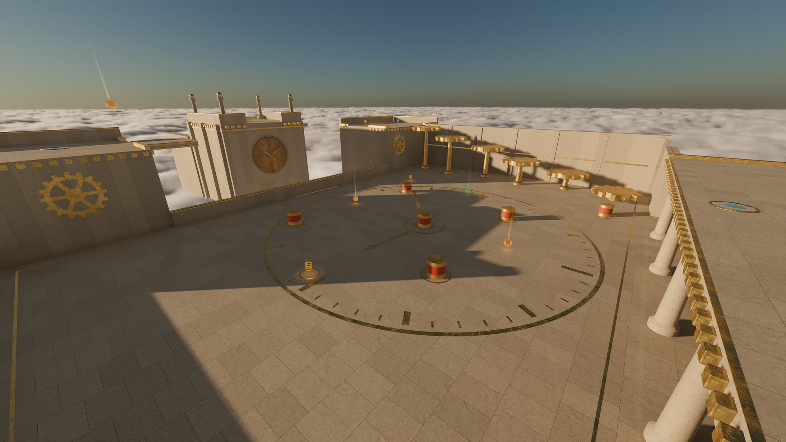
</p>

<h1 align="center">Orrery</h1>

<p align="center">
  A 3D marble platformer in a world of honey stone, aged brass and clockwork.<br>
  Roll a glass marble through courts above the clouds, collect every gem and beat the clock.
</p>

<p align="center">
  <a href="https://github.com/seanGSISG/orrery/releases"><b>Releases</b></a>
  &nbsp;·&nbsp; Windows and Linux &nbsp;·&nbsp; Controller or keyboard and mouse
</p>

## Roll, jump, beat the clock

<p align="center">
  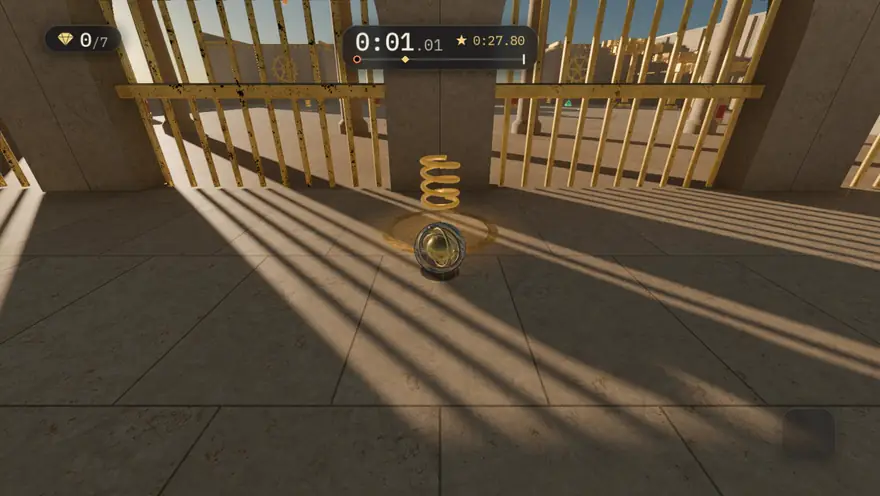
</p>

- **A marble that rolls.** The marble is a spinning sphere. Your input sets its spin, so it grips, slides, bounces and keeps its speed like a real ball.
- **Gems, then the finish.** Collect every gem in the level. The finish pad opens when the last gem is in.
- **Fast retries.** Hazards push the marble but never break it. After a fall, the marble is back on the last checkpoint, or the start pad, in half a second. One button restarts the level.

## Race your best

- **Par and gold.** Beat the par time to qualify and open the next level. Beat the gold time for the gold medal. The level select shows your best time, medal and egg for each level.
- **Ghosts.** The game records your best run of each level and races it beside you as a see-through marble.
- **Clockwork Eggs.** A jewelled Clockwork Egg hides off the main route of every level, and more hide on the climb. Find one and it opens. Where they are is for you to find.

<table>
  <tr>
    <td width="50%">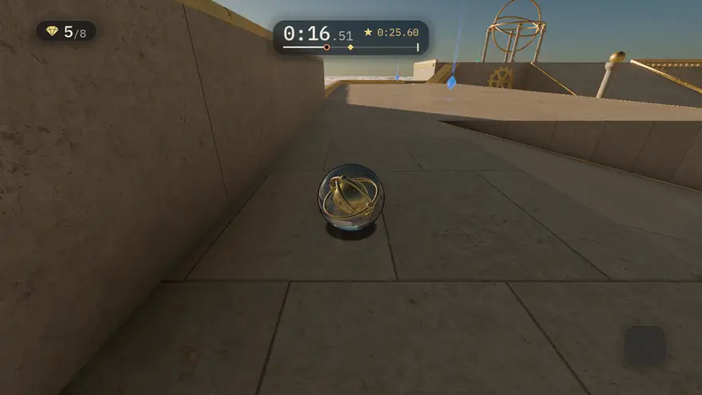</td>
    <td width="50%">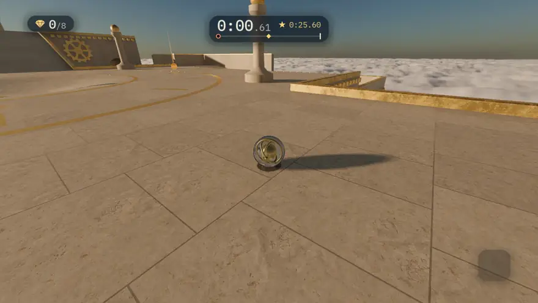</td>
  </tr>
  <tr>
    <td align="center">A gold time and a new record</td>
    <td align="center">Racing the ghost of the best run</td>
  </tr>
</table>

## Levels

Three Beginner levels, each with its own objects to learn.

<table>
  <tr>
    <td width="33%">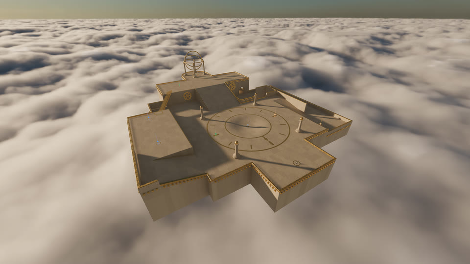</td>
    <td width="33%">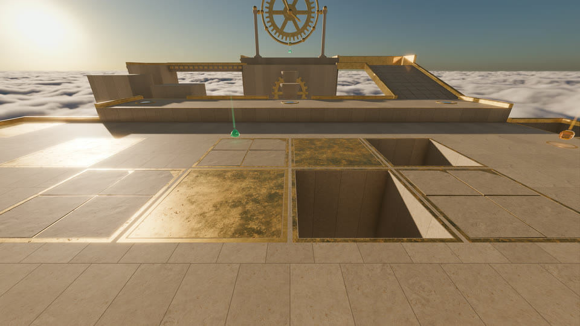</td>
    <td width="33%">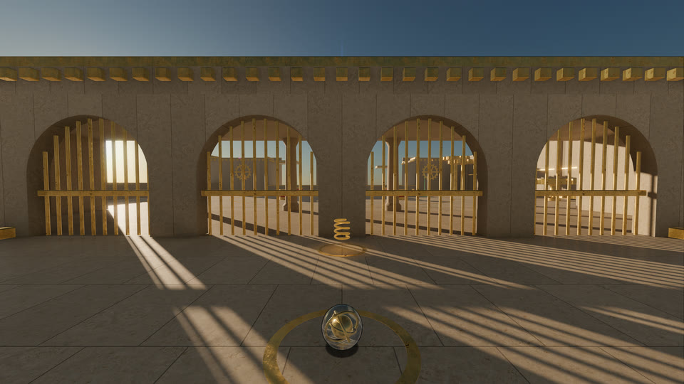</td>
  </tr>
  <tr>
    <td valign="top"><b>B1 Dawn Plaza</b><br>An open gem hunt on four floors. You choose the order of the 8 gems.<br><sub>Par 0:51.3 · Gold 0:25.6</sub></td>
    <td valign="top"><b>B2 Loose Hours</b><br>Jumps and checkpoints, then a hall where trapdoors and crumbling tiles are the puzzle.<br><sub>Par 0:49.3 · Gold 0:27.9</sub></td>
    <td valign="top"><b>B3 Spring Court</b><br>The Coil Spring for high jumps, with bumpers, turning gears and moving platforms.<br><sub>Par 1:33.6 · Gold 0:27.8</sub></td>
  </tr>
</table>

## Ascent

One long climb from a town square on the ground up a broken clock tower and into the sky. Open from the start.

<table>
  <tr>
    <td width="33%">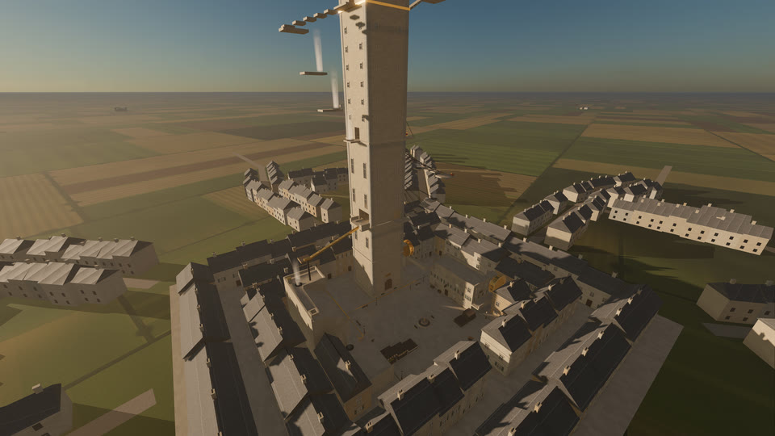</td>
    <td width="33%">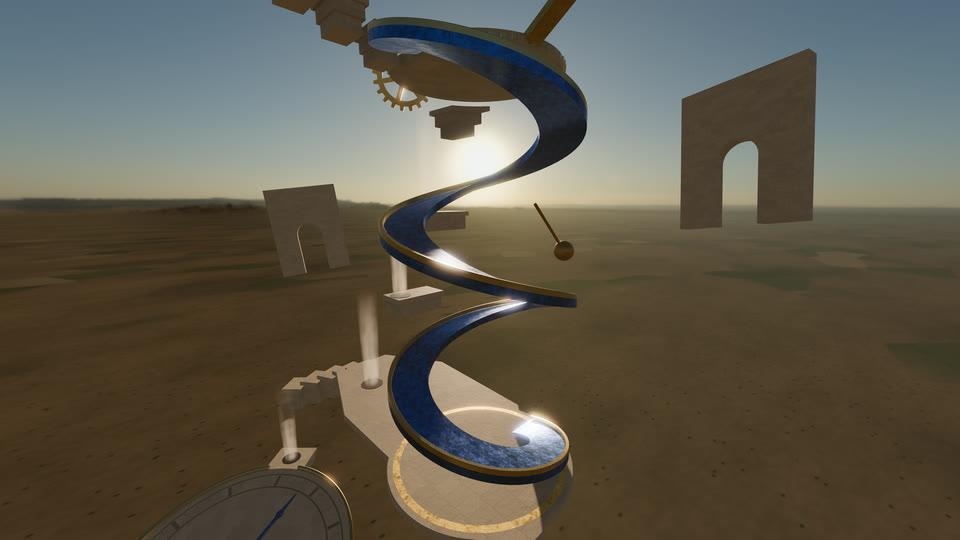</td>
    <td width="33%">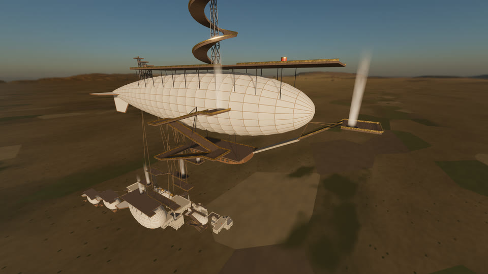</td>
  </tr>
  <tr>
    <td valign="top"><b>1 · Clockmaker's Square</b><br>0 to 150 m. Up the full height of the clock tower, inside and out.</td>
    <td valign="top"><b>2 · The Broken Tower</b><br>150 to 300 m. Through the clock's own parts: its face, gears, mainspring, bells and spire.</td>
    <td valign="top"><b>3 · Sky Harbour</b><br>300 to 500 m. Over floating roofs and moored airships to the gate.</td>
  </tr>
</table>

- **No checkpoints.** A fall costs height, not the run. A big fall can drop you into the zone below.
- **Quit any time.** The game saves your exact spot and continues from there.
- **Assist** adds a checkpoint at the start of each zone. An assisted climb keeps no record.
- **Your climb, measured.** A height meter, a flag at your best height, and a stats screen at the gate: time, falls and metres fallen. The ghost of your best climb climbs with you.
- **The light follows the height**, from the low dawn sun in the square to bright noon at the top.

<table>
  <tr>
    <td width="50%">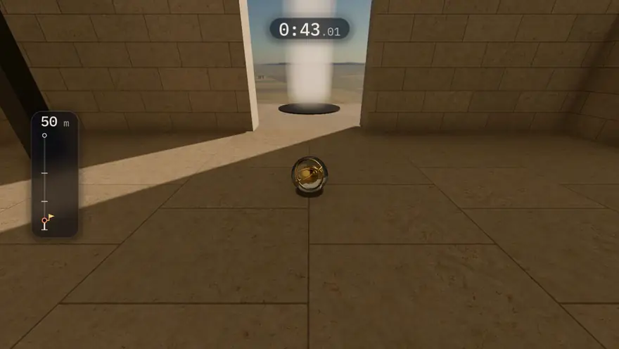</td>
    <td width="50%">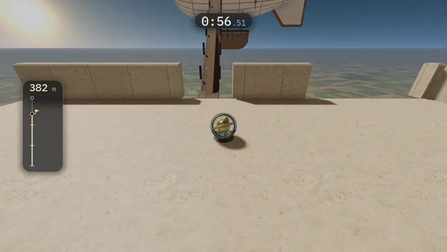</td>
  </tr>
  <tr>
    <td align="center">A steam vent lifts the marble up the clock tower</td>
    <td align="center">Up a plank past an airship, 400 m above the fields</td>
  </tr>
</table>

## Graphics and settings

- **Four quality presets.** Low, Medium, High and Ultra. High and Ultra add screen-space reflections and ambient occlusion, volumetric fog and FSR 2.2 anti-aliasing at native resolution. Ultra is made for 4K. The baked light of each level is the same on every preset.
- **Display.** Windowed, borderless or fullscreen. Window size, a frame cap from 30 to 240 fps or none, V-Sync, and HDR output on displays that support it. The HUD and menus stay sharp at any resolution.
- **Audio.** Master, music, effects and interface volume. Its own soundtrack: a title theme, a Beginner track and an Ascent track.
- **Accessibility.** A colourblind palette for gems and hazards, and each gem colour has its own cut. Camera shake can be turned off.

## Controls

The game plays fully with an Xbox controller or with keyboard and mouse. The button icons on screen follow the device you used last, and a controller can connect at any time. Rumble marks landings, bumpers and power-ups. You can rebind every gameplay action, for the keyboard and for the controller, in Settings.

| Action | Controller | Keyboard and mouse |
|---|---|---|
| Roll | Left stick | W A S D |
| Camera | Right stick | Mouse (click the game first) |
| Jump | A | Space |
| Use power-up | X or RT | Left click |
| Restart | View | R |
| Pause | Menu | Esc |
| Menus: choose, back | A, B | Enter or Space, Esc |
| Menus: change tab | LB, RB | Q, E |

## System requirements

- **OS:** Windows 10 or 11, or Linux. 64-bit (x86_64) only.
- **GPU:** Vulkan support. On Windows, the game falls back to Direct3D 12 when Vulkan is not available.
- **Target:** 1080p at 60 fps on the Medium preset with a GTX 1660 or RX 5600-class GPU.
- No network access, no telemetry. Saves and settings stay on your PC.

## Install and run

Download the latest build for your system from the [Releases](https://github.com/seanGSISG/orrery/releases) page. The builds are early test releases. Each one is a single file of about 650 MB that holds the whole game.

**Windows**

1. Download `orrery-<version>-windows-x86_64.zip` and extract `orrery.exe`.
2. Run `orrery.exe`.
3. The game is not signed yet, so Windows SmartScreen can show "Windows protected your PC". Click **More info**, then **Run anyway**.

**Linux**

```text
mkdir orrery
tar -xzf orrery-*-linux-x86_64.tar.gz -C orrery
./orrery/orrery.x86_64
```

## Build from source

Orrery is built with Godot 4.7.2 and Blender 5.2.4 LTS. The levels are Blender Python scripts that build into the game. With [`just`](https://github.com/casey/just) installed:

```text
just setup          # install and check the pinned tools
just build-levels   # build every level
just run b01        # play a level in a window
just export         # Linux and Windows release builds in build/
```

[`docs/plan.md`](docs/plan.md) holds the design, the architecture and every command.

## Credits and licenses

Orrery's levels, code and design are its own. The third-party textures, fonts and tools, and the AI models used for parts of the music and art, are listed with their sources and licenses in [`docs/licenses.md`](docs/licenses.md).

<sub>Coming next: Intermediate and Advanced levels, the rest of the climb to space, and new power-ups.</sub>
